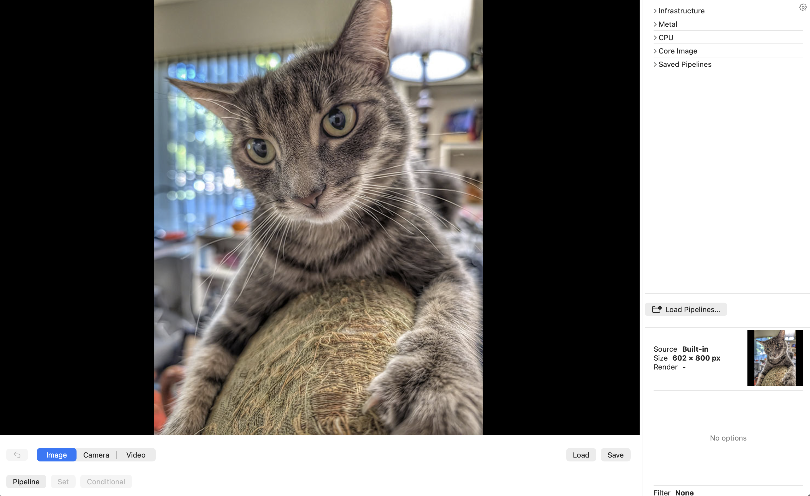
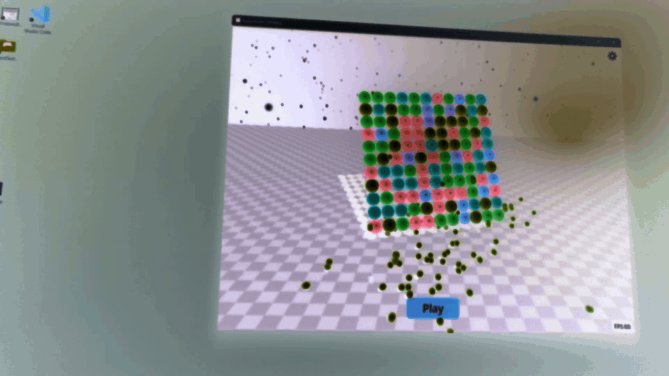
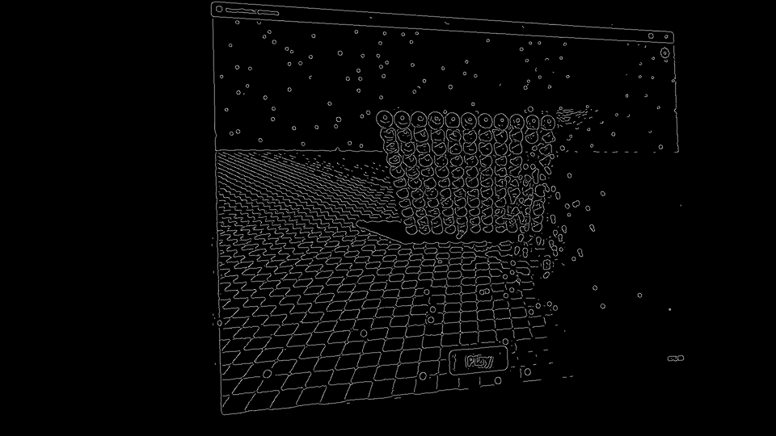

# FilterView
Stuart Rankin\
October 2026

# Summary
This is a program that applies various graphical filters to user-selected images, which may be saved at the user's discretion. App allows for input from an existing image file, a photo taken by the device's camera, and a video stream from the devices camera. Filtered video streams may be saved.

## Filters
For the purposes of this app, a filter is anything that modifies an image.

## Input
There are two primary types of input for FilterView:
1. Still images (drag and drop, load an image file)
2. Video stream

## Pipelines
A pipeline is a sequence of filters. One filter stage is fed into the next. Filters can branch and rejoin the main pipeline at other (but not retrograde) stages.

# Filters
There are four major types of filters, grouped by implementation.

## CPU
CPU filters run on the CPU and are not GPU-accelerated. The canonical filter for this is the Atkinson Dithering filter. Initially, it ran significantly slower than GPU filters. With optimization, it is now on a par with the GPU. (Atkinson runs on the CPU because of error diffision is difficult on GPUs.)
## CoreImage
iOS/macOS have many CoreImage filters. Many were incorporated into FilterView.
## OpenCV
OpenCV is an open source computer vision framework that has filtering capabilities. OpenCV required building it for embedding rather than relying on the libraries being present on any given system. OpenCV filtering is available only on the macOS version of FilterView.
## Metal
Metal is Apple's name for its GPU shader language. Several Metal filters were incorporated, including some I directly Claude to write, MPS filters, and filters I wrote myself.

# User Interface
The window that opens with the app is the main window and consists of a large view for the current image, a tree of filters, associated options, and controls for selecting input and opening and controlling the pipeline window. The user can access settings by tapping the gear button in the upper right.

Example of the main user interface.\

The large image will change when the user changes a filter. The image can be saved at anytime but the changes are transitory in the sense selecting another filter will stop using the previous filter. The original image is not changed (unless the user overwrites it intentionally). The smaller duplicate on the right side is unchanging so the user knows the extent of the filter changes.

The sample image (and used as a source for many examples) is shown below:\

Filters are selected by opening the filter tree in the upper right and tapping on a given filter. Options, if any, for the filter are at the bottom, under the base image. Options can be reset, and are saved for future instantiations.

## Pipelines
Pipelines are the most important part of FilterView. They allow users to create combined filters, save them, and use them later. Pipelines can be embedded in other pipelines, allowing for functional composition. Pipelines can be edited in place and stages added or removed.

The pipeline user interface with no pipeline stages yet added:\

# Copyright and License

Copyright 2026 Stuart Rankin

Licensed under the Apache License, Version 2.0 (the "License");
you may not use this file except in compliance with the License.
You may obtain a copy of the License at

    http://apache.org

Unless required by applicable law or agreed to in writing, software
distributed under the License is distributed on an "AS IS" BASIS,
WITHOUT WARRANTIES OR CONDITIONS OF ANY KIND, either express or implied.
See the License for the specific language governing permissions and
limitations under the License.
